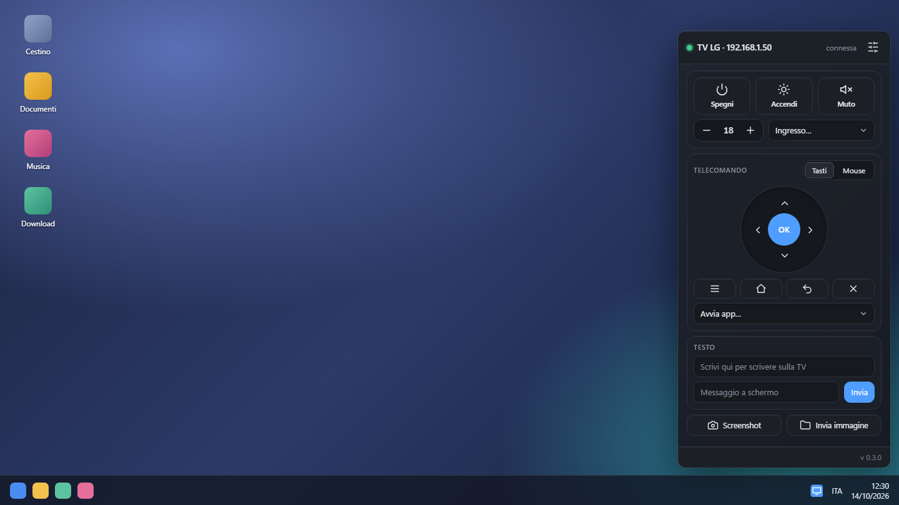
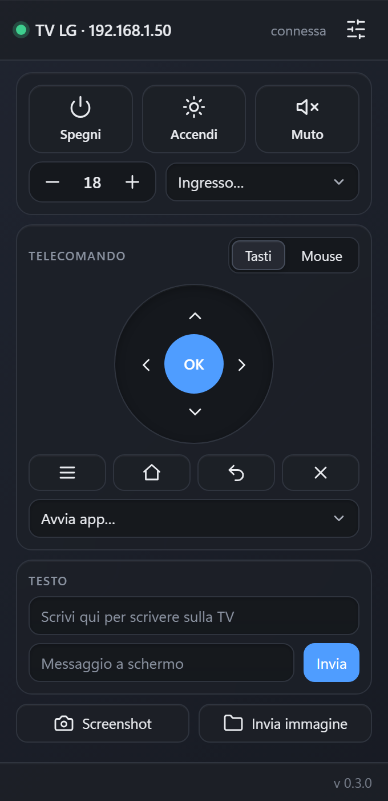
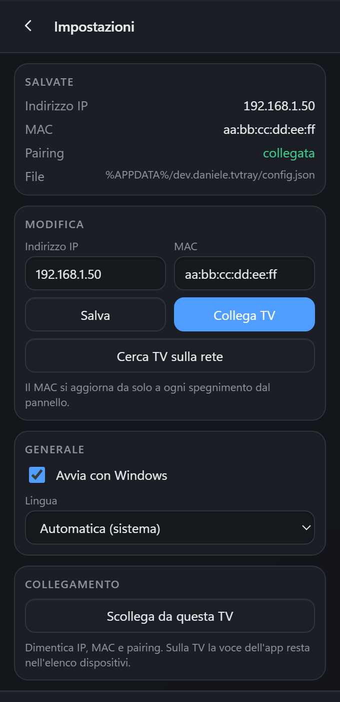

# TV Tray: telecomando per TV LG webOS dalla barra di Windows

🇬🇧 [English](README.md) · 🇮🇹 Italiano

Piccola app per Windows che vive nella barra delle applicazioni, accanto all'orologio, e fa da
**telecomando LG per Windows 10 e 11**. Controlla una **TV LG webOS** sulla stessa rete:
telecomando, volume, ingressi, app, messaggi a schermo, screenshot e invio di immagini, e
accende la TV con **Wake-on-LAN**.

Funziona senza Developer Mode, senza account LG ThinQ e senza installare nulla sulla TV.
Usa il protocollo di controllo locale della TV (SSAP, porta 3001).

> Provata su una TV LG con webOS 25. Su altri modelli e versioni il comportamento non è verificato.

<p align="center">
  
</p>

<p align="center">
  
  &nbsp;&nbsp;
  
</p>

<sub>Immagini illustrative: il desktop è un mock-up e indirizzo IP e MAC sono valori di esempio.</sub>

## Cosa fa

- **Accensione e spegnimento:** spegne la TV; la accende con Wake-on-LAN (il MAC viene rilevato
  da solo la prima volta che la spegni dal pannello).
- **Audio:** volume su e giù, muto.
- **Ingressi e app:** cambia ingresso (HDMI…), avvia le app installate.
- **Telecomando:** croce direzionale con OK, Menu, Home, Indietro, Esci. In modalità *Mouse* il
  riquadro funziona da trackpad (puntatore della TV), con clic, rotella e tasto destro = indietro.
- **Testo:** la tastiera del PC scrive nel campo di testo attivo sulla TV.
- **Messaggio a schermo:** mostra un avviso sulla TV.
- **Screenshot:** salva lo schermo della TV in `Immagini\TV Screenshots`.
- **Invia immagine:** mostra un JPG o PNG del PC sul browser della TV. L'immagine viene ridotta
  a 1920×1080 prima dell'invio; l'originale non viene toccato.
- **Lingua:** italiano e inglese, a scelta dalle Impostazioni (di default segue Windows).
- **Ricerca della TV** sulla rete e collegamento guidato; avvio automatico con Windows (opzionale).

## Primo avvio

1. Avvia TV Tray: compare l'icona nella barra e il pannello si apre da solo.
2. L'app cerca le TV LG sulla rete. Se ne trova una la collega; sulla TV compare una richiesta
   di accoppiamento: accettala con il telecomando.
3. Da qui in poi il pannello si apre con un clic sull'icona; il tasto destro apre il menu
   (Apri, Spegni TV, Esci).

La TV deve essere accesa e sulla stessa rete del PC. Se la ricerca non la trova, inserisci
l'indirizzo IP a mano da **Impostazioni**.

## Dove sono i dati e le chiavi

- La configurazione sta in `%APPDATA%\app.tvtray\config.json`: indirizzo IP, MAC e la
  chiave di accoppiamento.
- La chiave di accoppiamento è **cifrata con la protezione dati di Windows (DPAPI)**: vale solo
  per il tuo utente su questo PC. Se cambi utente o PC bisogna rifare l'accoppiamento.
- Nessuna chiave è nel codice né nel repository. «Scollega da questa TV» nelle Impostazioni
  cancella indirizzo, MAC e chiave.
- Per l'invio delle immagini l'app apre per breve tempo un piccolo server HTTP sulla rete
  locale, con un indirizzo non indovinabile, e lo chiude dopo un'ora o all'invio successivo.
  Windows può chiedere di consentire l'accesso al firewall.

## Compilare

Servono Rust (toolchain MSVC) e `tauri-cli` 2.x.

```powershell
cd src-tauri
cargo run                 # versione di sviluppo (debug)
cargo tauri build         # installer NSIS in src-tauri\target\release\bundle\nsis
```

L'interfaccia è un unico file `ui/index.html` (HTML, CSS e JavaScript, senza bundler),
incorporato nell'eseguibile al momento della compilazione.

L'installer non è firmato: Windows mostra l'avviso SmartScreen alla prima esecuzione.

## Struttura

| Percorso | Contenuto |
|---|---|
| `ui/index.html` | Interfaccia del pannello |
| `src-tauri/src/main.rs` | Comandi, tray, finestra, configurazione |
| `src-tauri/src/ssap.rs` | Client SSAP verso la TV |
| `src-tauri/src/discovery.rs` | Ricerca delle TV sulla rete |
| `src-tauri/src/dpapi.rs` | Cifratura della chiave con DPAPI |
| `src-tauri/src/capture.rs` | Screenshot |
| `src-tauri/src/i18n.rs` | Messaggi nativi (italiano e inglese) |
| `src-tauri/src/share.rs` | Server temporaneo per l'invio delle immagini |

## Evoluzioni

Le idee rimandate sono in [`ROADMAP.md`](ROADMAP.md) (in inglese).

## Riconoscimenti

- Il manifesto dei permessi (`src-tauri/src/pairing.json`) deriva da
  [`lgtv2`](https://github.com/hobbyquaker/lgtv2) (licenza MIT).
- Il funzionamento del protocollo SSAP e di Developer Mode è stato ricavato dall'osservazione
  della TV e di [webOS Dev Manager](https://github.com/webosbrew/dev-manager-desktop)
  (Apache-2.0); nessun suo codice è incluso.
- TV Tray non è affiliata a LG Electronics. «LG» e «webOS» sono marchi dei rispettivi proprietari.
